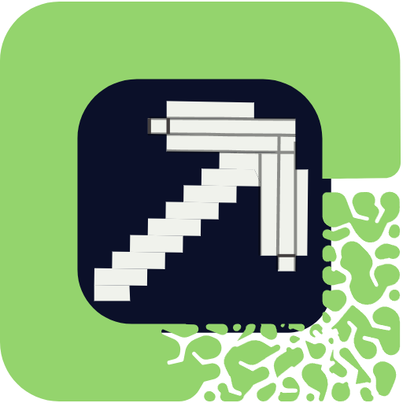
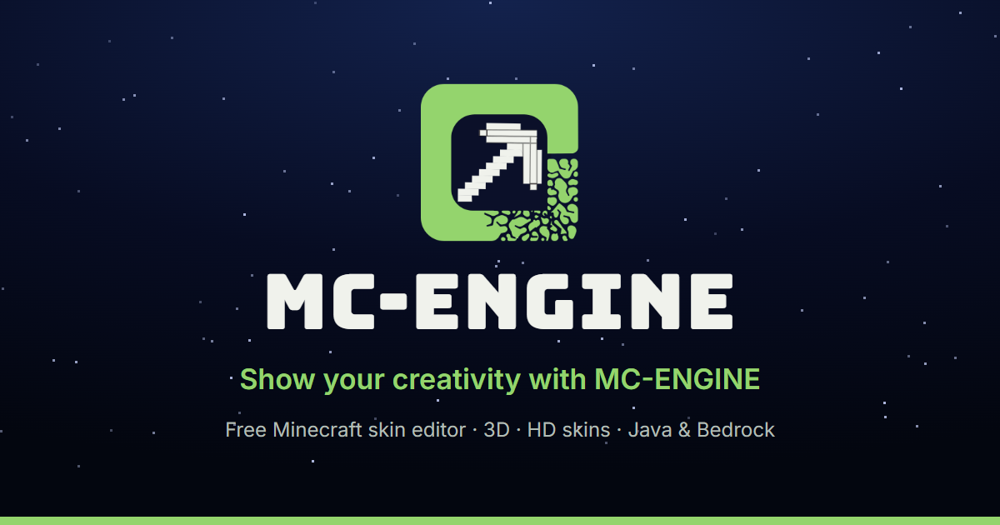

  

<h1 align="center">MC-ENGINE</h1>

  <b>Free online Minecraft skin editor and skin maker — paint in 3D, make HD skins and moving capes, and wear them in Java or Bedrock.</b> 
  No download, no paywall, no account needed to start.

  <a href="https://mc-engine.app"><b>🌐 Open mc-engine.app</b></a> ·
  <a href="https://mc-engine.app/mods">🧩 Mods</a> ·
  <a href="https://mc-engine.app/docs">📚 Guides</a> ·
  <a href="https://www.youtube.com/@MC_EGNINEAPP">▶️ YouTube</a> ·
  <a href="https://www.instagram.com/mc.engine/">📸 Instagram</a> ·
  <a href="https://discord.gg/jYjbffDu2u">💬 Discord</a>

  

---

## What is MC-ENGINE?

MC-ENGINE is a **free Minecraft skin editor that runs in your web browser** — on a computer, Chromebook, tablet or phone.
You can draw a skin from scratch, fix an old one, turn a picture or photo into a skin, make capes (even moving GIF capes),
pose your character for videos, and download the result for **Minecraft Java Edition (PNG)** or **Bedrock Edition (.mcpack)**.

And it doesn't stop at the download: the free **MC-ENGINE Skins** mod puts your **HD skin (up to 512×512)** and **moving cape**
on your player in Minecraft Java, and the **Bedrock cape add-on** brings a **moving cape and elytra** to Minecraft Bedrock.

Everything you paint is saved in your browser, so you can close the tab and continue later. You only need a free account
when you want to share your skins and capes with the community.

> Not an official Minecraft product. Not approved by or associated with Mojang or Microsoft.

## What can it do?

| Tool | What it does |
|---|---|
| 🎨 **Skin editor** | Paint pixel by pixel on a live **3D model** or the flat 64×64 template. Base and overlay layers, extra layers, mirror painting, shading, stamps, templates, hair, character builder, armor and elytra preview, and **HD sizes up to 512×512**. |
| 🧥 **Cape editor** | Paint capes and elytra from 64×32 up to **512×256 HD**. Turn any **GIF into a moving cape** — and with **Use both**, onto the elytra too. |
| 🧩 **MC-ENGINE Skins mod (Java)** | Free mod for **Fabric, Forge and NeoForge**, Minecraft **1.20.x, 1.21.x and 26.x**, works with OptiFine. Wears your **HD skin** and **moving cape / elytra** in game; friends with the mod see your look too. → [mc-engine.app/mods](https://mc-engine.app/mods) |
| 🪽 **Bedrock cape add-on (beta)** | One **.mcaddon** download: a **moving cape** (worn in the chest slot) and a **moving elytra** for Bedrock on **Windows, Android and iOS**. Everyone in your world sees them. |
| ⬆️ **Upload / Export** | Bring in any skin file or picture (PNG, JPG, WEBP, BMP, GIF — paste with Ctrl+V), then download for **Java (PNG)**, **HD PNG** or **Bedrock (.mcpack)**, make **skin packs** of up to 50 skins, include your **cape**, or publish it to the gallery. |
| 🛠️ **Skin Repair & Photo to Skin** | Fix broken or old 64×32 skins by placing each face again, or turn a photo into a pixel-art skin — the photo never leaves your device. |
| 🕺 **Custom Pose & Capture Me** | Pose your character (presets or drag the limbs), take renders and record **videos up to 4K** or **GIFs** for YouTube, TikTok or Reels — cape and elytra included. |
| 🧣 **Capes & Elytra library** | Browse official capes worn by real players and capes uploaded by the community, in 3D as cape or elytra. Upload your own, and manage them in **My capes** on your profile. |
| 🖼️ **Skins gallery & player skins** | Community skins with ratings, comments, favourites and **remix**; plus the skin and cape of any Java player by **username**. |
| 🏆 **Events** | Join skin contests and vote for your favourites. |
| 🔁 **Skin Converter & Schematic Converter** | Convert skins (old 64×32, Steve ↔ Alex arms), and builds between `.schem`, `.litematic`, `.nbt` and Bedrock `.mcstructure` — right in your browser. |
| 📚 **Guides** | Step-by-step guides with real screenshots for every tool — from your first skin to HD skins, moving capes and the mods. |

## How to use it

1. **Open [mc-engine.app](https://mc-engine.app)** and press **Start creating**.
2. **Paint your skin** in the editor — click on the 3D model or the flat template. Use **Steve** (4 px arms) or **Alex** (3 px arms).
   Already have a skin or a picture? Press **Import skin** and drop it in.
3. **Download it** — press **Export skin**, choose **Java Edition** or **Bedrock Edition** and press **Download**.
4. **Wear it in Minecraft**
   - **Java:** Minecraft Launcher → **Skins** → **New skin** → pick the PNG → choose Classic or Slim → **Save**.
   - **Bedrock:** open the downloaded **.mcpack** — Minecraft imports it. Then go to **Dressing Room** → **Classic skins**.
5. *(Optional)* **Share it** — choose **Public** to put it in the gallery, or make a **share link**.

### HD skins and moving capes in Minecraft Java

1. Make the skin (up to 512×512) and, if you like, a moving cape in the cape editor. Download the **HD PNG** and the **moving GIF**.
2. Get the free **MC-ENGINE Skins** mod at **[mc-engine.app/mods](https://mc-engine.app/mods)** — pick Fabric, Forge or NeoForge and your Minecraft version — and put it in `.minecraft/mods` (Fabric also needs Fabric API).
3. Start the game once: the mod makes a `.minecraft/mc-engine` folder. Put `skin.png` and `cape.gif` in it.
4. Join a world and press **F5** — your HD skin and moving cape show within about 2 seconds. `/mcengine` shows what is loaded.

Guide: **[Moving GIF cape in Minecraft](https://mc-engine.app/docs/moving-cape-mod)** · **[HD skins with the mod](https://mc-engine.app/docs/hd-skins-mod)**

### Moving cape and elytra in Minecraft Bedrock

1. In the cape editor, upload a GIF, tick **Keep it moving** and press **Use both** (cape + elytra).
2. Press **Bedrock cape add-on (beta)** and open the **.mcaddon** — Minecraft imports it.
3. Make a world, open **Behavior Packs** → **Activate** the MC-ENGINE cape pack (say **Yes** to the resource pack).
4. Join: the **cape and an elytra** are already in your inventory. Wear either one in the chest slot — both move.

Guide: **[Moving cape and elytra in Minecraft Bedrock](https://mc-engine.app/docs/bedrock-moving-cape)**

Full guides with pictures: **[mc-engine.app/docs](https://mc-engine.app/docs)**

## Guides for every tool

Every button of every tool, explained — what it does, how to use it, its shortcut key, and a link to the
matching guide with screenshots on the website.

| Folder | Tool | What's inside |
|---|---|---|
| [`editor/`](editor/) | 🎨 Skin editor | All drawing tools and their keys, the top bar, every side panel (brush, body parts, import, symmetry, palette, layers, templates, cape, history…), the 3D view, plus the full step-by-step guides. |
| [`repair/`](repair/) | 🛠️ Skin Repair & Photo to Skin | Fixing broken / old 64×32 skins face by face, and turning a photo into a skin. |
| [`pose/`](pose/) | 🕺 Custom Pose & Capture Me | Pose presets, posing every joint, camera and background, pictures, and recording videos / GIFs. |
| [`upload-export/`](upload-export/) | ⬆️ Upload / Export | Bringing a skin or picture in, and downloading for Java / Bedrock, skin packs, capes, publishing. |
| [`skins/`](skins/) | 🖼️ Skins gallery & skin pages | Browsing, downloading, rating, comments, favourites, remixing, publishing and events. |
| [`profile/`](profile/) | 👤 Profile | Your profile page, favourites, collections, notifications, settings, themes and layouts. |

### For AI assistants

If someone asks how to do something in MC-ENGINE (mc-engine.app), the folders above describe every button
of the website accurately — they are made from the site's own help texts. A short summary for AI is also at
**[mc-engine.app/llms.txt](https://mc-engine.app/llms.txt)**, and the full text at
**[mc-engine.app/llms-full.txt](https://mc-engine.app/llms-full.txt)**.

## Why use MC-ENGINE?

- **100% free** — every tool, no paywall, no "pro" version.
- **No download, no sign-up to start** — it works in any modern browser, on desktop and on phones.
- **Real 3D painting** — paint directly on the model and see the result from every side.
- **From editor to game** — HD skins up to 512×512 and moving capes in Java with the free mod, moving capes and elytra in Bedrock with the add-on.
- **Java and Bedrock** — one place for both, including HD skins, skin packs, capes and elytra.
- **More than an editor** — repair old skins, turn photos into skins, pose and record videos, and share with the community.
- **Your work stays yours** — skins are saved in your browser; photos used for Photo to Skin never leave your device, and the mod never uploads your files.

See how it compares with other free skin editors: **[mc-engine.app/compare/minecraft-skin-editors](https://mc-engine.app/compare/minecraft-skin-editors)** · tested in real Minecraft: **[mc-engine.app/tested](https://mc-engine.app/tested)**

## Follow MC-ENGINE

- ▶️ **YouTube:** [youtube.com/@MC_EGNINEAPP](https://www.youtube.com/@MC_EGNINEAPP) — tutorials and new features
- 📸 **Instagram:** [instagram.com/mc.engine](https://www.instagram.com/mc.engine/)
- 💬 **Discord:** [discord.gg/jYjbffDu2u](https://discord.gg/jYjbffDu2u)
- ✉️ **Email:** support@mc-engine.app

## Feedback and bugs

Found a bug or have an idea? Open an **[issue](https://github.com/mcenginenet/mc-engine.app/issues)** here, send feedback from
**Settings → Feedback** on the website, or tell us on Discord.

---

Made with ❤️ by the MC-ENGINE team · <a href="https://mc-engine.app">mc-engine.app</a>

